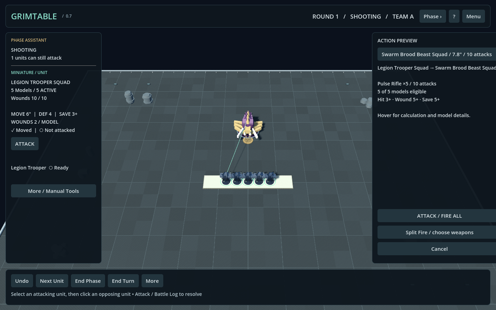
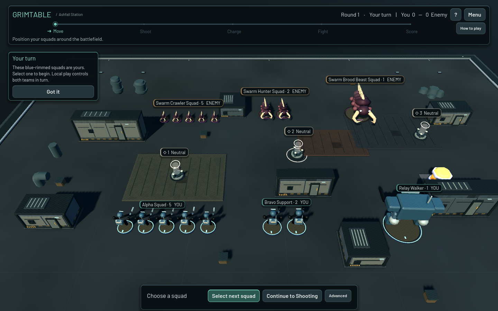
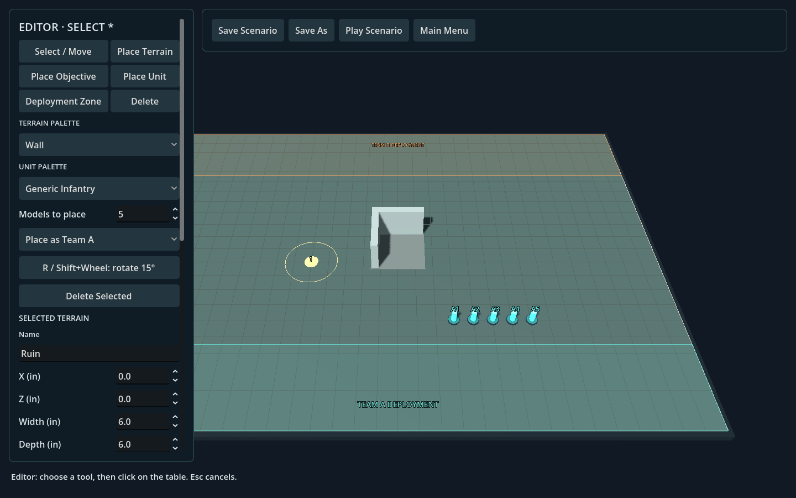
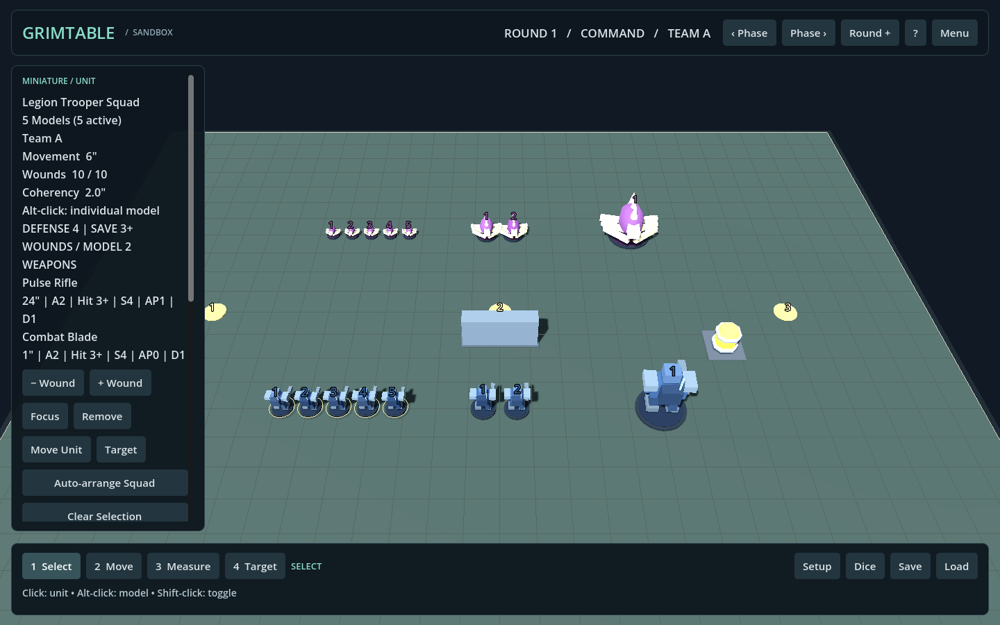

# GrimTable

A reusable local desktop 3D miniature tabletop in **Godot 4.6.1 / typed GDScript**. Create scenarios, play with generic miniatures, save battles, and replay recorded actions. Includes four original demo factions, data-driven profiles, and generic tabletop automation. Unit visuals are permanent original GrimTable artwork; licensed Kenney CC0 terrain kits are included. No commercial rules database, accounts, network service, or paid dependency is required.

## License

Original GrimTable code, documentation, scenarios and artwork are available
under the [MIT license](LICENSE). Third-party assets, fonts and WebRTC components
retain their separate licenses; see [THIRD_PARTY_NOTICES.md](THIRD_PARTY_NOTICES.md).
See [CONTRIBUTING.md](CONTRIBUTING.md) to contribute.

## Living Battlefield + AI Opponent (0.10.0)

**Play alone against the computer:** choose **Play**, a scenario, your side,
AI opponent and Easy/Normal/Hard difficulty, then **Start Battle**. Guided defaults
to Easy. Human hotseat and AI-vs-AI remain available. AI uses the same legal
movement, combat, charge, allocation and scoring APIs; its recorded actions save
and replay normally.

Units now react with cosmetic idle, alert, movement, aim, attack, hit and defeat
motion. Terrain/objective hover cards explain mechanics; hold **T** for temporary
tactical ranges, objective zones, terrain traits and coherency links. Ashfall adds
machinery, steam and warning lamps. Movement and AI pacing have Fast/Normal/Cinematic
settings. Match endings offer statistics, Save Replay, Play Again and Main Menu.

**Validation:** 1,306 Godot checks passed in one full regression run. The fresh
standalone Windows build passed 15 graphical AI workflow checks, including two
rounds, seven AI moves, five attacks, scoring, save/load and exact replay.
Three deterministic AI-vs-AI seeds completed without illegal actions or stalls.
Medium measured 157/81 FPS at 100/200 models on the documented GTX 1660 Ti setup.

No new third-party miniature meshes were retrieved; original miniatures and the
existing licensed Kenney terrain remain. AI uses bounded single-step utility
planning and is local only. Individual large formation checks can still hitch.

Windows build: `builds/windows/GrimTable.exe` (local export; binaries are excluded from Git) ·
[Full milestone report and performance](docs/LIVING_AI_0100.md) ·
[Tactical view](docs/living_tactical_0100.png) ·
[Match summary](docs/living_summary_0100.png)


## Diorama presentation (0.9.0 history)

GrimTable now has one shared tactical UI theme, licensed Barlow typography,
a connected phase timeline, floating action dock, proper unit cards and compact
world plates that offset/suppress overlapping labels. A live rendered Ashfall
menu introduces the battlefield. Smaller Guided callouts keep the board visible.

The original miniature library has beveled mechanical parts, articulated limbs,
curved biological sculpts and shared faction PBR palettes. Framed industrial
terrain, service roofs, vents, doors, hazard details, holographic objectives,
a worn procedural mat and physical table surround create a cohesive diorama.
Combat gains short cosmetic feedback and grouped dice chips. Gameplay remains
in the existing authoritative engine; no new rules/network/mod systems were added.

Final aggregate: **1,228 passing Godot checks**. The full regression ran once;
only the affected old caption assertion received a targeted follow-up. The Windows
package passed **65 graphical workflow checks**, with **11 focused presentation
checks** after small screenshot-driven corrections. Medium measured **146/83 FPS
at 100/200 models** on the documented GTX 1660 Ti setup.

[Before](docs/visual_before_080.png) · [After](docs/visual_after_090.png) ·
[Live menu](docs/visual_menu_090.png) · [Full visual report](docs/VISUAL_090.md)


## Learn through play (0.8.0 history)

Fresh installs start in **Guided** mode: a visual Move ? Shoot ? Charge ? Fight ?
Score tracker explains the current activity, a single action dock shows what to
do next, and compact hints teach selection, movement, targets and objectives.
**Standard** keeps automation without tutorials; Tabletop and Custom remain.
Existing Assisted settings migrate to Standard.

Squad ownership banners, ready base rims, objective beacons, a compact unit card,
legal formation alternatives, visible **Why?** attack explanations and direct
model-click damage allocation make the battlefield easier to read. Ashfall Station
starts with three squads per side, a nearby objective and a clear shooting lane.
Original procedural ground/terrain and miniature silhouettes are also improved.

Final aggregate: **1,205 passing Godot checks**. The full regression ran once;
only affected UI checks followed fixes. The Windows package passed **37 fresh-profile
workflow checks** and **11 focused damage/round UI checks** after visual corrections.
The 100/200-model spot check measured **134/73 FPS** on the documented GTX 1660 Ti.
See the [UX report](docs/GUIDED_080.md) for before/after screenshots, performance,
validation details and remaining usability limits.


## Assisted tabletop play (0.7.0 history)

**Players choose tactics. GrimTable handles the mechanics.** The normal flow is
Select → Move → click destination → Confirm, or Select → Attack → enemy → Fire All.
A unique legal attack target defaults reversibly. Charge rolls, legal formation
previews, difficult-ground costs, cover, dice, damage, objectives, scoring and
per-unit action tracking use the existing authoritative engine.

Assisted, Tabletop and Custom presets control quick movement, combat pacing,
phase suggestions, camera assistance and optional allocation/casualty automation.
The new decision panel keeps confirmations visible; manual tools and referee
corrections live under More. Auto Deploy and Ready include collision/coherency
validation and Focus guidance. Exact save/replay outcomes remain recorded.

Final aggregate: **1,161 passing Godot checks**, with the full runner used once
and targeted follow-ups only. The fresh Windows package passed **32 graphical
smoke checks**. A minimal two-client check matched automatic attack dice, allocated
damage, score and state hash. Performance was about **137/82 FPS at 100/200 models**
on the documented GTX 1660 Ti system, close to 0.6's 139/83.

See the [automation report](docs/AUTOMATION_070.md) for click counts, settings,
rules semantics, validation scope and limitations.



## Player experience (0.6.0 history)

Launch **Play / Ashfall Station** for the new showcase. This release adds warm/cool
battlefield lighting, three procedural board themes, stronger faction silhouettes,
muted material palettes, beveled bases, integrated selection rings and a rendered
battlefield menu. Medium/High quality offer shadows and MSAA; Low keeps them off.

The phase assistant finds unmoved units and units that can attack. Formation and
deployment helpers propose legal positions for confirmation. Attack Control lists
eligible targets, groups loadouts, supports split assignments and resolves groups
sequentially while retaining manual damage allocation. Exact recorded dice animate
in a short combat summary; explicit cover areas can modify saves. Settings control
presentation, warnings, scoring and optional allocation/removal automation.

The final regression aggregate is **1,070 passing Godot checks**. The full runner
was used once; discovered regressions were fixed and only affected suites rerun.
A short real two-client check confirmed identical cover, dice and state hashes.
Medium-quality performance measured **139 FPS at 100 models** and **83 FPS at 200**
on the documented GTX 1660 Ti system. See the [0.6.0 report](docs/EXPERIENCE_060.md)
for precise behavior, Windows verification, performance data and limitations.



## External packs and large battles (0.5.0 history)

Install data-only packs in `user://mods/`, then open **Main Menu ? Mods** to inspect,
enable/disable and reload them. Packs can add factions, units, weapons, scenarios
and restricted static GLB visuals without rebuilding the application. Scripts,
external Godot scenes and native extensions are not loaded. See
[MODDING.md](docs/MODDING.md) and the ready-to-copy
[Frontier Expedition example](examples/mods/example_army).

Live saves record required pack versions; snapshot-backed replays can use fallback
art when packs are missing. The existing multiplayer gate checks enabled pack IDs,
versions and gameplay hashes. No mod downloads or networking infrastructure were
added. All authored miniature visuals remain permanent fallbacks; the official
Quaternius retry still encountered restricted/manual downloads.

The benchmark measured about **223 FPS at 100 models**, **135 FPS at 200**, and
**95 FPS at 300** on this machine after static visual batching and event-driven
preview/control updates. These are uncapped local measurements with documented
limits, not universal targets. See [PERFORMANCE.md](docs/PERFORMANCE.md).

The final regression ran once: **1,007 Godot checks passed**. A minimal fresh
Windows package smoke passed external pack discovery and scenario startup.
[Full milestone report](docs/MOD_PERFORMANCE_REPORT.md) includes assets, validation
scope, hardware/results, package status and limitations. The later [licensing decision](docs/LICENSING_DECISION.md) applies MIT to original project work.



## Faction content milestone (0.4.0 history)



The main menu now offers **Legion vs Swarm** and **Horde vs Synthetics**, alongside
all existing scenarios. Sixteen unit archetypes and twelve weapons are registered
in `resources/content.json`; the editor palette reads the same catalog.

**Asset limitation:** the requested Quaternius miniature downloads were unavailable
(Poly Pizza HTTP 403; official Drive quota exceeded). No Quaternius meshes were
shipped. Distinct original procedural miniatures stand in for them. Both Kenney
kits were verified CC0 and imported: 97 Space Station Kit and 40 Modular Space Kit
GLBs. The milestone's requested CC0 miniature replacement is therefore incomplete.
Exact sources, failed candidates, checksums and license notices are recorded in
[ASSETS.md](docs/ASSETS.md) and [the asset registry](assets/third_party/assets.json).
Original project work is now [MIT licensed](LICENSE); third-party notices remain independent.

Attack / Battle Log now has weapon choice, live range/LOS eligibility, attacker
highlights, a dice-count preview and explicit confirmation. New profiles use
positive AP penalties; old signed profiles still work. Damage allocation and
casualty removal stay manual by default; settings can automate them on the host.

Objectives count living bases by team, display control, and optionally award
scenario points once per full round. Scores and profile/weapon snapshots survive
save/load and deterministic replay. Auto-arrange proposes a nearby formation
using existing legality checks; confirmation is still required. See
[CONTENT.md](docs/CONTENT.md) for conventions and precise automation semantics,
and [MILESTONE_REPORT.md](docs/MILESTONE_REPORT.md) for validation evidence/limits.

Development tools: `python tools/fetch_assets.py --check`,
`python tools/audit_assets.py`, and the license/checksum-gated
`tools/import_visual.gd`. Gameplay never downloads assets.


## Launch

**Windows:** run `builds/windows/GrimTable.exe`. Keep the accompanying WebRTC DLL and license files in the export folder. The release has embedded game resources and does not require the Godot editor.

**Online multiplayer:** Main Menu → Multiplayer → Create Online Game / Join Online Game.
Share a six-character room code. Both players must configure the same community
WSS signaling server in Network Server Settings. No public hosted service is
provisioned; the default is the local development service. Start it with:

```sh
cd server/signaling
npm ci --ignore-scripts
npm start
```

ENet LAN / Direct IP remains under Advanced Multiplayer. The host owns Team A,
the guest Team B; the host validates actions and rolls all dice. See
[networking](docs/NETWORKING.md) and [self-hosting / Docker / coturn](docs/SELF_HOSTING.md)
for native dependency details, protocol, security limits, TURN credentials,
runtime test status, and deployment commands. The native plugin is vendored in
`addons/webrtc_native/`; no global installation is required.

**Source:** import `project.godot` into Godot 4.6.1 standard edition and press **F5**. The startup scene is `scenes/main/app.tscn`; `scenes/main/main.tscn` remains the directly runnable tabletop composition used by existing tests.

The main menu offers **Play Demo Battle**, Play Scenario, Scenario Editor, Load Game, Replay, Settings, and Quit. The one-click demo contains two squads, scenery, objectives, and opposing deployment zones. The browser also includes **Empty Battlefield** and saved custom scenarios.

## Scenario editor

Open Scenario Editor, select a scenario and Edit, or choose New Scenario.

| Tool / control | Use |
|---|---|
| Select / Move | Click and drag terrain, objectives, zones, or an entire unit |
| Alt-click a miniature | Select and reposition that model individually |
| Place Terrain | Choose Wall, Ruin, Crates, Barricade, or Block; click the table to place |
| Place Objective | Add a marker, then edit its name, number, radius, and X/Z position |
| Place Unit | Choose a faction unit or legacy generic profile; set team and model count |
| Deployment Zone | Create a rectangle; select it to edit team, center, width, and depth |
| Delete / Delete Selected | Remove selected terrain, objective, unit, model, or zone |
| R / Shift + wheel | Rotate a terrain preview, selected terrain, or selected unit formation by 15 degrees |
| Escape | Cancel a drag/preview and return to Select |
| Apply Selected Properties | Commit fields in the selected-object inspector |
| Apply Scenario Properties | Change scenario name/notes, board size, initial round, phase, player, and deployment state |
| Save Scenario | Update the current custom scenario |
| Save As | Create a separately named custom copy; bundled scenarios remain unchanged |
| Play Scenario | Start a fresh game from the current editor layout |

Placement tools show translucent previews. Terrain exposes separate movement/LOS flags and rotation. Ruins use a reusable L-shaped footprint for meshes, collision, and movement checks. Objective radii are shown in editor mode. Unit placement uses full formations and existing generic profiles.

The left inspector scrolls; Save, Save As, Play, and Main Menu remain in the fixed toolbar. Click/drag moves objects immediately; typed property changes require Apply. Invalid placements or malformed data produce a status message and retain/restore the previous valid layout. Models cannot overlap bases or blocking terrain. Editor arrangement is independent of normal movement/deployment allowances.

Board dimensions support **12–120 inches** per axis. Shrinking a board is rejected while object centers or zones would fall outside it; rearrange those objects first. Rectangular deployment zones must fit entirely on the board. Terrain may overlap other terrain and may extend partly beyond the board edge.

Custom scenarios live in `user://scenarios/` and appear automatically in the browser. Scenario files describe starting layouts, not in-progress wounds, casualties, combat results, or action history.

## Playing

**One world unit = one inch.** The demo board is 60 × 44 inches. Bases are measured horizontally, edge to edge for range and coherency.

| Input | Action |
|---|---|
| WASD / middle drag | Pan |
| Wheel | Zoom |
| Q / E | Rotate |
| Right drag | Orbit and tilt |
| F / Home | Focus selection / reset camera |
| Left click | Select a squad |
| Alt + click | Select one model |
| Shift + click | Add/remove a squad; combine with Alt for individual models |
| 1 / 2 / 3 / 4 | Select / Move / Measure / Target |
| M | Measure |
| Escape | Cancel the entire provisional movement/tool |
| Ctrl+Z / Ctrl+Y | Undo / redo confirmed gameplay actions |
| Delete | Confirm removal of selection |
| Space | Advance phase after deployment |
| F3 / F4 | Collision/base overlays / LOS rays |

Squad movement records every model's origin and accumulates distance over successive drag segments. Origin markers, ranges, remaining movement, and coherency links are visible. **Confirm Move** checks bounds, base/terrain collisions, movement budgets, and connected unit coherency. **Cancel Move** restores the entire formation. The default coherency distance is two inches between base edges. Manual coherency override is explicit and logged; it never overrides collision or distance limits.

Deploy models freely within their team's colored zones, confirm staged moves, then click **Start Game**. Normal movement begins and the zones disappear. Movement budgets apply per squad transaction; players track how many actions their rules permit. Alt-selected individual movement retains its original immediate, per-drag workflow.

The Measure tool locks a line between two tabletop points. Hovering another miniature shows base-edge range. Objectives expose control radii. Setup mode repositions existing terrain and objectives during a game.

Target an opposing unit with **4**, open **Attack / Battle Log**, and Confirm Attack. Eligible living shooters require range and terrain LOS to a living target. Each hit/wound/save roll is shown and recorded using the existing dice generator. Damage waits for explicit allocation to a selected target model. Defeated models remain until Remove Casualty. Attacks, wounds, casualties, movement, and objective/terrain movement support undo/redo; redo never rerolls an attack.

The generic prototype attack compares strength and defense for a wound threshold, adjusts saves by AP, and pools failed-save damage for manual allocation. It is not a complete commercial ruleset. The independent D6 tray, history, generic phase tracker, and manual wound controls remain available.

## Saves and auto-save

Game saves use explicit **`format_version: 2`** and contain:

- Scenario ID/path reference plus an embedded initial scenario, so a custom source file may later be renamed or deleted.
- Current model positions, wounds and removed flags, scenery transforms/properties, objective positions, round, phase, player, and deployment state.
- Structured chronological action history, readable battle-log content, and current attack/pending damage.
- An explicit indication that runtime undo/redo stacks reset on load. Their execute/undo/redo events remain available to replay.

Manual saves use `user://grimtable_save.json`. Optional auto-save uses `user://autosave.json`, replacing one slot after confirmed actions or phase changes. It never captures provisional squad movement. Both slots are available from Load Game. Saves use temporary-file replacement and validate input before restoring the world.

Legacy version-1 demo saves can load and migrate to version 2. Their older logs did not record all transitions, so they are explicitly marked non-replayable; the app reports that limitation instead of fabricating a replay. Start a new scenario for complete recording.

Scenario, game-save, and replay files are separate formats. See [SCHEMA.md](docs/SCHEMA.md).

## Replay

Use **Menu → Save Replay**, or open Replay from the main menu and choose a game save/auto-save/replay archive. Replay files live in `user://replays/`.

Controls include Start, Previous Action, Play, Pause, Next Action, a draggable timeline, and **0.5× / 1× / 2× / 4×** speed. The view shows the current event index, round/phase/player, and recorded attack results.

Replay reconstructs the initial scenario and applies structured object/property deltas in sequence, including execute, undo, redo, attacks, damage allocation, casualties, objectives, and turn changes. Movement animates during forward playback. Seeking rebuilds from the initial scenario for correctness. Playback is read-only and never calls the dice roller; integer roll arrays are restored exactly from recorded data.

The timeline counts history events, including attack-roll records and their corresponding state-changing commands. Long histories may seek slowly because V1 rebuilds the whole prefix. New replays embed gameplay profile/weapon snapshots. Older archives without snapshots still depend on installed legacy definitions.

## Settings

Settings persist in `user://settings.cfg`: fullscreen/windowed, window resolution, camera sensitivity, measurement decimal precision, and auto-save. Window presets are 1280×800, 1440×900, and 1920×1080. Fullscreen uses the display's mode. Audio and edge scrolling are not implemented, so there are no inactive volume/edge-scroll controls.

`user://` is Godot's OS-specific application-data folder. Application code uses portable `res://` / `user://` paths; no development-machine directory is required.

## Architecture

The existing tabletop services remain in place. New layers compose and extend them:

| Area | Responsibility |
|---|---|
| `scripts/scenario/scenario_definition.gd` | Versioned JSON schema, IDs, dimensions, profiles, validation |
| `scripts/scenario/scenario_library.gd` | Bundled/custom discovery, read errors, atomic scenario saves |
| `scripts/scenario/scenario_factory.gd` | Assemble/capture existing reusable units, terrain, objectives |
| `scripts/editor/scenario_editor.gd` | Explicit editor tools, previews, transformations, placement validation |
| `scripts/game/interaction_controller.gd` | Routes editor input exclusively, or runs existing gameplay tools |
| `scripts/game/app.gd` | Startup menu, browser, session lifecycle, settings, load/replay screens |
| `scripts/game/world_state.gd` | Serializable current world state and stable-ID registry |
| `scripts/game/json_store.gd` | Recoverable JSON read/parse errors |
| `scripts/replay/action_codec.gd` | Whitelisted structured action validation and replay application |
| `scripts/replay/replay_controller.gd` | Playback clock, stepping, seeking, movement animation, archives |
| `scripts/ui/editor_panel.gd`, `replay_panel.gd` | In-game editor and replay controls |
| `scripts/game/actions/` | Existing reversible property-delta commands and action history |
| `scripts/game/battle_log.gd` | Sequence-numbered structured and readable event history |
| `scripts/game/save_service.gd` | Version-2 persistence and legacy-save compatibility |

Scenario data now defines all demo board dimensions, terrain, objectives, armies, deployment zones, and starting state. The main scene no longer assembles a hardcoded demo. Existing movement, coherency, selection, measurement, combat, dice, camera, and unit scenes are reused.

## Validation and desktop exports

Run the isolated check runner, which clones a small validation project with a separate application-data identity:

```sh
godot --headless --path . --script res://tools/run_checks.gd
```

It runs all ten suites without touching the player's normal saves/settings:

- Original tabletop: **275 checks**
- Squads/combat: **76 checks**
- Scenarios/replay: **48 checks**
- Application/editor/auto-save/path checks: **175 checks**
- Networking authority/hash/serialization/menu checks: **48 checks**
- Internet readiness, renewal, compatibility and channel checks: **67 checks**
- Real unavailable-service socket checks: **3 checks**
- New content/models/combat/scoring/save/replay checks: **251 checks**
- External mod packs: **54 checks**
- Performance cache correctness: **10 checks**

**1,007 Godot checks pass** in the 0.5.0 final regression. The 19 signaling/probe tests passed in the previous milestone and were not repeated because the backend/protocol is unchanged. Separate two-process WebRTC and ENet smoke tests pass, including the native Windows export. Local signaling-process failure and added application latency were tested. Public WSS/STUN/TURN and different-network play remain untested. See [PUBLIC_TEST_REPORT.md](docs/PUBLIC_TEST_REPORT.md) for the acceptance matrix. Rendered screen checks use `tests/render_application.gd`. Exported-build smoke checks use `-- --smoke-export`; networking checks use `tools/network_smoke.ps1` and the separate-machine `tools/internet_peer.ps1`.

Export presets and artifacts:

| Platform | Artifact | Validation |
|---|---|---|
| Windows x86-64 | `builds/windows/GrimTable.exe` | Native standalone launch, embedded resources, game/scenario persistence, editor, replay movement, 1280×800 UI smoke passed |
| Linux x86-64 | `builds/linux/GrimTable.x86_64` | Export generated; ELF64/x86-64 structure checked; not run on Linux |
| macOS universal | `builds/macos/GrimTable.zip` | Unsigned app archive generated; universal x86-64/arm64 header checked; not run on macOS |

See [BUILD.md](docs/BUILD.md) for reproducible export commands, templates, signing, and platform limits. This Windows environment reports a system certificate-store warning during engine startup; it has not prevented offline gameplay, exports, or validation.

## Known limitations and next milestone

- The editor has manual object transforms and numeric zone resizing, not gizmo handles, polygon zones, an army builder, or editor undo. Gameplay undo remains available.
- The board is flat: no climbing, upper floors, flying, or 3D range. Terrain LOS is a simple body-height ray.
- Generic combat supports multiple equipped weapons per unit and pooled damage. It does not enforce a complete ruleset or per-turn action spending. Online ownership and active-team checks are enforced by the host.
- Undo stacks are session-local and clear on load/Start Game. Replay retains the chronological effects of earlier undo/redo.
- Replays rebuild prefixes when seeking. Old archives without embedded profiles depend on installed definitions. Legacy incomplete logs cannot be reconstructed.
- Linux/macOS packages require target-OS runtime testing. macOS signing/notarization is not configured.
- Online play requires a configured community/self-hosted signaling and TURN deployment; no hosted default service is provided. No reconnect, host migration, accounts or matchmaking. AI is available for local battles. Route diagnostics are unavailable with the pinned native API. TURN and remote WSS need deployment testing.
- TURN credentials are refreshed and cached before expiry, including authenticated signaling reattachment. The pinned native peer cannot apply them to a live allocation or restart ICE. See [RECONNECT.md](docs/RECONNECT.md) for exact scope; no gameplay reconnect button is advertised.

Recommended next milestone: obtain the unavailable verified CC0 miniature assets, replace the authored substitutes through the import pipeline, and perform a large-army performance pass. Public-VPS WSS/TURN testing, reconnect/ICE restart, and Linux/macOS runtime QA remain outstanding.

