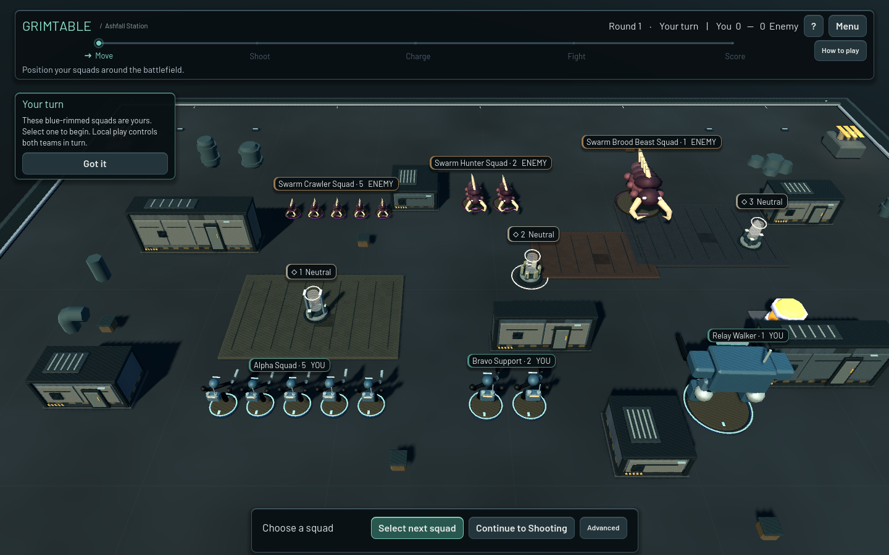

# GrimTable 0.10.0 — Living Battlefield + AI Opponent

Verified on Windows on 2026-10-17, Godot 4.6.1, Compatibility/OpenGL.

Start `builds/windows/GrimTable.exe`, choose **Play**, select a scenario, side,
opponent and difficulty, then **Start Battle**. Guided defaults to Easy;
Standard defaults to Normal. Human hotseat and AI-vs-AI are also available.
Local AI uses no network or external inference service.

## Presentation and interaction

`UnitAnimationController` has Idle, Selected, Moving, Aiming, Attacking, Hit and
Defeated states. Canonical movement commits immediately. The visual root then
interpolates from its old location; base collision, range, LOS and replay state
use the destination throughout. Fallback motion adds restrained breathing,
alert lean, locomotion, aim, recoil, hit tilt and defeated slump. Available
AnimationPlayer clips can be matched by state name; shipping authored models
use the procedural fallback. Fast/Normal/Cinematic movement speeds and Reduce
Motion are respected. Idle updates run at 10 Hz, with distance/visibility limits.

Existing selection rims, world plates, formation ghosts, eligibility marks,
recorded combat tracers and camera assistance are reused. Target hover adds
weapon attacks, range/visibility counts and hit/wound/save inputs. Terrain hover
explains blocking, LOS, cover and difficult ground; objective hover gives ownership,
nearby team counts and end-of-round points. These inspect existing rules data.

Hold **T** for temporary movement ranges, objective zones, coherency links,
terrain footprints and text traits. Release restores the clean view and previous
terrain-overlay visibility. Focus loss and opening the session menu clear it.
Space retains phase advance. F7 toggles developer AI diagnostics.

Ashfall gains original nonblocking machinery, warning lamps, gantry, rubble and
two sparse steam emitters, suppressed by Low quality, particles settings or
Reduce Motion. Objective devices have three cosmetic silhouettes with animated
holograms, ownership colors, contested state and ownership-change pulses.
No audio system or new sound assets were added.

[Tactical view](living_tactical_0100.png) · [AI movement](living_ai_move_0100.png) ·
[Match summary](living_summary_0100.png)

## Assets and licensing

No new third-party miniature meshes were imported. The existing original faction
models remain in use, alongside the previously verified Kenney CC0 Space Station
Kit and Modular Space Kit and Barlow OFL fonts. Their unchanged notices and
checksums remain in `assets/third_party/assets.json` and the Windows licenses folder.
All new machinery, motion and objective variants are original GrimTable work.

The creator pages were checked again and identify these Quaternius packs as CC0:

| Candidate | Creator source | Result |
|---|---|---|
| Animated Mech Pack | https://quaternius.com/packs/animatedmech.html | No archive retrieved |
| Animated Tanks Pack | https://quaternius.com/packs/animatedtanks.html | No archive retrieved |
| Ultimate Monsters | https://quaternius.com/packs/ultimatemonsters.html | No archive retrieved |
| Ultimate Space Kit | https://quaternius.com/packs/ultimatespacekit.html | No archive retrieved |

The browser could read the creator pages; ordinary requests from the workspace
were refused by its network environment. `asset_retry_0100.json` records the
attempts. Earlier manual-download/quota limitations remain in `ASSETS.md` and
the registry. Restrictions were not bypassed, and no unverified substitute was
shipped. Rigged imported character animation remains unvalidated with real assets.

## AI behavior

`AIController` schedules bounded high-level decisions. `AIPlanner` reads public
profiles and uses the existing formation, collision, movement, coherency, range,
LOS, combat, charge, allocation, phase and scoring APIs. All resulting actions
enter canonical history. Replay applies those records without rerunning AI.

Difficulty weights live in `resources/ai/{easy,normal,hard}.json`. Easy evaluates
8 movement candidates with more seeded variation and lower objective/threat
weights. Normal uses 16 with sensible objective and finishing-target priorities.
Hard uses up to 26 with stronger objective, kill, cover and threat weights and
less variation. There are no difficulty stat bonuses.

Movement candidates point toward objectives/enemies and sampled nearby directions.
Legal formation proposals are scored for objective distance and ownership,
weapon range, melee approach, nearby threats and cover. Already controlled
objectives have reduced attraction. Exact legality is checked before commitment.
Target utility combines estimated attacks × hit probability × wound probability
× failed-save probability × damage, with wounded-unit and objective-holder bonuses.
No future combat rolls are inspected or consumed by planning.

Charge utility uses configured dice success probability, melee strength, distance
and the cost of leaving a controlled objective. Close combat uses the normal
weapon/target eligibility API. AI defenders allocate through the existing
wounded-model-first suggestion and remove casualties through canonical actions.
Deployment reuses Auto Deploy; difficulty-specific deployment strategy is not added.

The planner considers a bounded number of squads per decision. Runtime movement
evaluation yields between complete candidate checks, after restoring every
temporary transform. Menu, replay, scene/configuration changes and new history
invalidate pending decisions. A three-second runtime planning budget, 512-action
phase budget and eight-invalid-action guard prevent runaway loops. A candidate's
formation check itself is synchronous. Normal/Cinematic action pauses and a
Speed Up button make turns readable; acting squads are selected visibly.

Saves include controlled teams, difficulties, seed, speed, round limit, completion
state and exact combat RNG state. Old saves without AI remain valid. The local
round limit is relative to the scenario's initial round. The session menu allows
surrender/finish. End-of-match UI shows outcome, score, objectives, remaining
models, defeated enemy models and damage, plus Save Replay, Play Again and Main
Menu. It takes priority over the Guided round tutorial.

V1 AI is local only and stops when a network session exists. No network-hosted
AI support is claimed. Gameplay action schemas and multiplayer world hashes did
not change; save additions are local metadata.

## Validation

The complete isolated Godot runner ran **exactly once**: **1,306 checks passed
across 16 suites**, zero failures. This includes 54 AI and 22 living-presentation
checks. Only affected Guided/animation checks and the focused graphical smoke
followed screenshot-driven layout corrections. No separate signaling matrix,
TURN, public-network or deployment tests were run.

AI checks cover ownership, seeded choices, exact state restoration after planning,
frame-spread/synchronous choice equivalence, cancellation on menu/load, objective
approach, finishing-target utility, no illegal-range attack, no planning dice
consumption, AI/RNG save/load, coherent legal actions, phase/round progression,
scoring, bounded completion and exact replay reconstruction.

Three Normal-vs-Normal two-round simulations completed without invalid actions
or watchdog skips:

| Seed | Steps | Moves | Attacks | Charge attempts | Damage allocations |
|---:|---:|---:|---:|---:|---:|
| 7 | 60 | 9 | 14 | 5 | 8 |
| 31 | 50 | 7 | 9 | 1 | 9 |
| 77 | 57 | 8 | 12 | 4 | 9 |

The simulation planning sample averaged 12.4 ms, worst 174.9 ms across 138
synchronous decisions. These small-board figures differ from the large-board
benchmark below. Raw results: `benchmarks/ai_simulations_0100.json`.

A fresh standalone Windows export, copied to a folder without project files,
passed **15 graphical workflow checks**, exit 0. Ashfall vs Easy completed two
rounds, seven AI moves and five AI attacks with objective scoring, AI save/load,
exact replay and an on-screen match summary. The smoke player held position and
ended its own phases; AI actions used the runtime planner. Charge opportunities
were exercised by the seeded simulations rather than forced into this walkthrough.
Reproduce with an isolated application-data profile: `GrimTable.exe -- --smoke-living`.

## Performance

Ryzen 5 2600, GTX 1660 Ti, Windows, Godot 4.6.1. Rendering spot check uses Medium,
1280×800, vsync off, 90 measured frames after warmup per mode:

| Models | Idle FPS | Movement frame | Targeting frame |
|---:|---:|---:|---:|
| 100 | 157.4 | 6.51 ms | 6.74 ms |
| 200 | 81.5 | 12.55 ms | 13.65 ms |

Raw results: `benchmarks/living_0100.json`. These are short local measurements,
not a stress test of simultaneous movement/VFX for every model or a GPU guarantee.

Normal AI, headless, seeded benchmark, one complete team turn, no cosmetic pacing:

| Models | Average decision | Worst decision | Worst candidate | Full team turn |
|---:|---:|---:|---:|---:|
| 10 | 10.2 ms | 70.5 ms | 3.6 ms | 192 ms |
| 40 | 81.8 ms | 384.8 ms | 43.7 ms | 1,552 ms |
| 100 | 238.7 ms | 989.1 ms | 102.8 ms | 8,622 ms |

Runtime decision times include yields/physics waits and do not represent one
continuous main-thread stall. Individual formation checks can still cause a
visible hitch at large counts. Raw runtime and pre-change synchronous reference:
`benchmarks/ai_runtime_0100.json`, `benchmarks/ai_0100.json`.

## Remaining weaknesses

AI is a bounded, one-step utility player with full battlefield information.
It has no multi-turn search, obstacle pathfinding, coordinated role assignment
or difficulty-specific deployment. Firing-position utility uses distance and
threat heuristics; final attack eligibility uses exact LOS. It can get stuck
behind complex terrain or choose a locally useful action over a stronger plan.
Scenarios with bespoke victory scripts and unsupported mod mechanics do not gain
specialized AI. Hard difficulty and arbitrary external packs need more playtesting.

Visuals still use procedural whole-root motion, rather than authored skeletal
walks, articulated weapon aiming or a full dissolve/death library. Objective
variants number three rather than six. Tactical labels can become crowded on
dense custom boards. No new sound pass, per-weapon audio or screen shake was
added. Decoration does not add climbing or upper-floor gameplay. Windows alone
was rebuilt and runtime-tested; Linux/macOS packages remain older builds.

The Windows build retains the existing harmless local certificate-store warning;
offline play and this smoke succeeded. Public-network acceptance remains separate.
