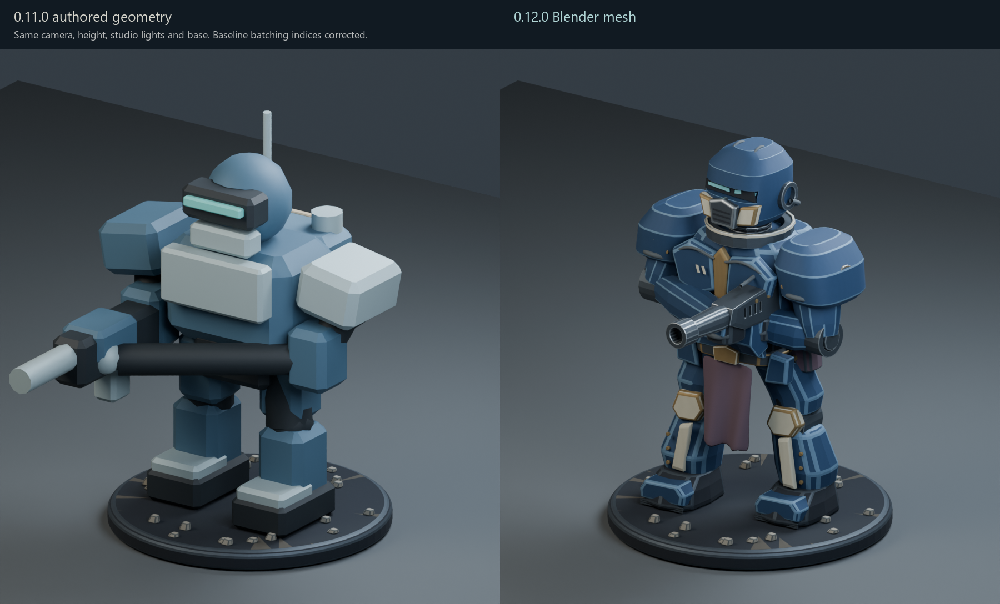

# GrimTable 0.12.0 — Miniature art pass

This release adds four original Blender-authored reference assets, a shared
painted-miniature material treatment, detailed cosmetic ground bases, and a
selected-miniature inspection studio. Gameplay profiles, base sizes, movement,
combat resolution, authoritative LOS and network serialization remain unchanged.
The assets are substantially more shaped and detailed than the previous models;
this is not a claim of independently certified professional sculpt quality.

## Assets and production

Created in Blender **5.0.1**, integrated in Godot **4.6.1**. All sources below are
editable, with separate source and evaluated game-export collections. Triangle
counts are evaluated full-detail exports, before Godot's generated LODs.

| Asset | Blender source | Game export | Triangles |
|---|---|---|---:|
| Legion infantry | [Source](../art/blender/legion_infantry.blend) | [GLB](../assets/miniatures/legion/legion_infantry.glb) | 54,344 |
| Heavy war walker | [Source](../art/blender/heavy_walker.blend) | [GLB](../assets/miniatures/legion/heavy_walker.glb) | 56,822 |
| Swarm creature | [Source](../art/blender/swarm_creature.blend) | [GLB](../assets/miniatures/swarm/swarm_creature.glb) | 90,764 |
| Ruined Basilica Manufactorum | [Source](../art/blender/ruined_basilica.blend) | [GLB](../assets/terrain/gothic/ruined_basilica.glb) | 100,720 |

The shared scenic base ground adds 3,344 triangles. Each major export is one mesh
and one atlas material. The original 1024×1024 pigment and metallic/roughness
atlases live in `assets/miniatures/materials/`; textures are also packed into the
Blender sources and embedded in the GLBs. Geometry assigns painted edge and dark
recess regions. There are no baked normal/AO maps or photographic texture scans.

The infantry uses contour-extruded and inset armor shells, a beveled recessed
helmet, connected mechanical joints, shaped greaves, a profile-extruded rifle
with muzzle opening, wrapped fingers, swept cables and folded cloth. The walker
adds articulated mechanical housings, pistons, contoured armor, cooling vanes,
recessed weapon assemblies and exhausts. The creature uses continuous voxel-unified
skin, subdivision-shaped anatomy, curved carapaces, mandibles, hooked claws and
a segmented tail. The building uses actual cut-through gothic windows, arch
stones, columns, buttresses, shattered walls, exposed reinforcement, broken floor
elements and industrial machinery. Primitive starting meshes are transformed
through these modeling operations; shaped geometry is the central improvement.

The Legion reference was reviewed before starting the other three assets. Its
[quality gate](art/INFANTRY_QUALITY_GATE.md) records eight visual criteria and
iterations addressing helmet shape, forearm bulk, floating fittings, attachment
points, material darkness and export orientation. A pre-existing mixed indexed/
unindexed SurfaceTool batching defect was also corrected; comparisons use the
complete previous geometry, rather than taking advantage of missing old armor.

## Visual review

Each asset has front, side, rear, hero and tactical renders under
[`docs/art/renders`](art/renders/). Matched Blender comparisons use identical
camera, lighting, normalized overall height and comparable bases. Legacy custom
Godot shaders are represented by their paint/metal factors in Blender; separate
native Godot infantry comparisons preserve their actual shader rendering.

| Asset | Hero render | Before/after |
|---|---|---|
| Infantry | [Render](art/renders/legion_infantry_hero.png) | [Comparison](art/comparisons/legion_infantry_side_by_side.png) |
| Walker | [Render](art/renders/heavy_walker_hero.png) | [Comparison](art/comparisons/heavy_walker_side_by_side.png) |
| Creature | [Render](art/renders/swarm_creature_hero.png) | [Comparison](art/comparisons/swarm_creature_side_by_side.png) |
| Basilica | [Render](art/renders/ruined_basilica_hero.png) | [Comparison](art/comparisons/ruined_basilica_side_by_side.png) |

The review sheets arrange unchanged renders; they do not retouch the models.
Native battlefield and close inspection captures are under
[`docs/art/gameplay`](art/gameplay/). The new **Iron Reliquary** scenario presents
all four assets together with legal routes, objectives and existing unit profiles.
It is also the main-menu diorama. The editor palette exposes the Basilica.

## Integration and reusable pipeline

`AuthoredArt` supplies cosmetic defaults for `legion_trooper`, `legion_walker`
and `swarm_hunter`. Existing local miniature assignments and explicit mod visuals
take precedence. Original authored models remain as fallbacks. The new ground
detail scales to the canonical base radius without changing collision or range.
Cosmetic muzzle markers align projectile VFX without changing gameplay LOS.

The Basilica uses the existing 13×10×7 gothic ruin presentation and conservative
L-shaped gameplay footprint. Visual openings do not create new firing rules;
some apertures remain blocked by the original LOS volume. Upper floors are
decorative. Explicit terrain scene overrides take priority over procedural art.
No arbitrary walkable surfaces or new collision rules were introduced.

All four assets are **static**: there are no skeletal rigs or animation clips.
Existing whole-miniature movement, aiming/recoil, hit and casualty fallbacks
continue to operate. This does not provide articulated walking legs or organic
limb animation.

The selected-unit **Inspect Miniature** action opens a separate studio viewport.
Drag to orbit, use the wheel to zoom, select Front/Side/Rear/Hero, and return with
Escape or Return to Table. Smooth studio camera transitions and full-detail
meshes support close inspection. Gameplay input is gated while inspecting and
the previous tactical camera and interaction state are restored on close.

See [the source guide](../art/README.md) for coordinate conventions, collections
and reproducible commands. `export_models.py` exports artist-edited source;
`build_assets.py` regenerates the original scripted design and must not be used
to preserve manual edits. Validation tools check Blender sources and GLB meshes,
UVs, finite coordinates, materials and degenerate faces. Godot generates LODs and
shadow meshes. Editable sources are excluded from the shipped package.

## Performance

One 100-model and one 200-model benchmark were run on Ryzen 5 2600 / GTX 1660 Ti,
Godot Compatibility, Medium, 1280×800, VSync off, 90 frames per measured mode.

| Models | Idle FPS | Movement frame | Targeting frame | Draw calls | Static memory |
|---:|---:|---:|---:|---:|---:|
| 100 | 135.6 | 7.71 ms | 7.86 ms | 2,982 | 157.1 MB |
| 200 | 78.8 | 12.82 ms | 13.29 ms | 4,998 | 173.9 MB |

[Raw measurements](benchmarks/art_0120.json). The previous milestone recorded
about 119.9/67.2 FPS. These short mixed-profile samples show acceptable performance,
but are not an isolated old-art control: the batching correction also changed
rendering. They do not establish performance for 200 full-detail walkers or a
worst-case close camera. No repeated AI, signaling, TURN or internet benchmark
matrix was run.

## Validation

- All four editable Blender sources and exported GLBs passed targeted validation:
  [sources](art/source_validation.json), [exports and hashes](art/asset_validation.json).
- The new art suite passed 74 checks covering cosmetic precedence, fallback,
  canonical base/LOS preservation, terrain, inspector state, movement fallback,
  persistence and indexed chamfer geometry.
- The **complete regression was executed once**: 1,678 checks, initially five
  failures in test assumptions. Two visual assertions assumed unindexed vertices;
  three terrain assertions expected procedural architecture even with an explicit
  scene override. Assertions were corrected to check indexed winding/normals and
  actual explicit scene instances. Only the affected visual (17) and terrain
  (190) suites were rerun, both with zero failures. Thus all 1,678 checks are
  resolved across the full run and focused follow-ups; there was no second full
  run and no claim of a clean first full run.
- [Regression digest](art/godot_validation_0120.txt) preserves that distinction.

The exported Windows standalone passed **27 checks, zero failures**, running from
an isolated copy with its bundled native DLLs and a fresh user profile. Checks
covered all new unit visuals, canonical bases, inspection/input restoration, one
legal AI round with combat, exact displayed D6 faces, exact save/load and replay.
See [the packaged result](art/packaged_validation_0120.json). The committed
gameplay screenshots were captured by this packaged run, including
[the tabletop](art/gameplay/art_tabletop_clean_0120.png),
[infantry inspection](art/gameplay/art_inspect_legion_trooper_0120.png) and
[the Basilica](art/gameplay/art_basilica_gameplay_0120.png).

The build is `builds/windows/GrimTable.exe`; keep its neighboring native DLLs and
license files when distributing the directory. One packaged smoke was executed.

## Provenance and remaining limitations

All new mesh geometry and pigment textures are original GrimTable work under the
repository MIT license. No third-party sculpt foundations, extracted game assets,
protected faction symbols or external model downloads were used. Existing asset
attributions remain in `THIRD_PARTY_NOTICES.md`.

The models establish a more coherent stylized identity, but still benefit from
manual sculpt refinement. Infantry fingers, cloth tension and some armor seams
are simplified; walker mechanisms are static; Swarm musculature is soft in some
views; broad stone surfaces and repeated damage details remain visibly authored
with reusable operations. Atlas tiles limit unique localized paint storytelling.
There are no high-to-low normal/AO bakes, skeletal animations or bespoke distant
artist-authored LODs. Most of the remaining roster still uses the previous art.

The recommended next art step is a manual sculpt/retopology pass on the infantry
hands and cloth and the creature's facial anatomy, followed by baked normal/AO
detail and a small tested locomotion rig. Preserve the current reference assets
and compare any replacement at the same tactical and studio cameras.
