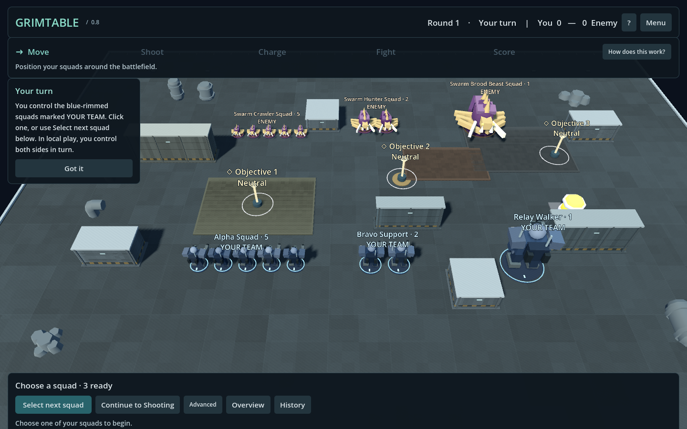

# GrimTable 0.9.0 — diorama presentation

0.9.0 establishes a graphite, steel and muted military visual identity around the
existing tabletop engine. This is an authored geometry/material/UI pass; gameplay
profiles, bases, collision, LOS, action payloads, saves, replay and networking
architecture were not rebuilt.

## Before / after

| 0.8 | 0.9 |
| --- | --- |
|  |  |

The opening shots use the same Ashfall armies and terrain layout. The new camera
is slightly lower and closer, and frames less empty foreground. Additional captures:

- [Live main menu](visual_menu_090.png)
- [Clean high-quality battlefield](visual_clean_090.png)
- [Unit card](visual_card_090.png)
- [Movement preview](visual_move_090.png)
- [Target preview](visual_attack_090.png)
- [Combat/damage at 1280×800](visual_combat_090.png)
- [Horde and Synthetics](visual_factions_090.png)
- [1280×720 layout](visual_1280x720_090.png)
- [2560×1440 layout](visual_2560x1440_090.png)

All images are actual Godot captures. No generated promotional image substitutes
for the running game.

## UI and typography

`GrimTheme` is the shared Godot Theme factory for the application, battle HUD,
unit cards, combat panels, coach cards, labels and tooltips. It centralizes colors,
spacing, corners, borders, shadows, button states and typography roles. Surfaces
have a dark translucent fill, a thin upper highlight, consistent rounded edges and
restrained shadows. Primary actions use a teal treatment; secondary controls have
less visual weight. No framebuffer blur pass was added.

The header and connected five-step phase timeline share one compact surface.
Completed/current/future steps have distinct shapes and contrast. The action dock
floats centrally and sizes to its contents, rather than permanently filling the
bottom of the screen. Unit cards use a heading/count, subdued archetype name,
large Move/Health/Armor values, compact weapons and action state. Advanced tools
keep their existing callbacks. Guided callouts are smaller and retire contextually.
Short fades and base-selection pulses use about 0.1–0.25 seconds; reduced motion
skips those transitions.

**Barlow Regular and SemiBold** provide the readable tactical sans-serif. Creator:
Jeremy Tribby / The Barlow Project Authors. These unmodified fonts are distributed
under [SIL Open Font License 1.1](https://github.com/google/fonts/blob/main/ofl/barlow/OFL.txt).
The verified license, original download URLs, retrieval date and SHA256 values are
in `assets/third_party/assets.json`; the full license is alongside the fonts and
in the Windows package's `licenses/fonts/` folder. No project-wide software
license was selected. See [ASSETS.md](ASSETS.md).

Thirteen original SVG symbols share a 24-pixel grid and consistent stroke weight:
Move, Shoot, Charge, Fight, Score, Health, Armor, Range, Objective, Measure,
Settings, History and Warning. They are paired with words in primary actions.
Move/target/measure modes use cross-platform native context cursors.

## World labels

Squad and objective labels now use small screen-space plates with contrasting
backgrounds, team accents and compact YOU/ENEMY text. Normal zoom shows squad name
and count; close zoom can add action status; overview reduces squads to markers.

A centralized layout tries bounded screen offsets and leader lines, then
suppresses lower-priority labels. Selected squads have priority, and labels avoid
visible inspection/preview/coach panels. Layout is capped at roughly 12 Hz and
skips work when camera, content and battlefield revision are unchanged. No unit
per-frame label or LOS loop was introduced. Dense-layout checks verify that visible
plates do not overlap. Suppression can hide a lower-priority label in a crowded
view; it does not merge gameplay units.

## Miniatures and materials

The permanent original sculpt library now builds reusable articulated forms:

- Legion: plated torso/backpack, helmet/visor, shoulder armor, armored boots,
  rifle stock/magazine/barrel and larger heavy weapon. Walkers have articulated
  hips/knees/shins, cockpit structure, weapon arms and sensors. Tanks have layered
  hulls, road wheels, tracks, turret ring, turret and a distinct main barrel.
- Horde: asymmetric scrap plating, oversized crude weapons, industrial pipes,
  spikes and mismatched equipment, including the war machine.
- Swarm: ellipsoid body segments, overlapping carapace, curved tapered legs,
  mandibles, tail, spines and two-sided wing membranes. It no longer relies on
  rectangular bars for its organic limbs.
- Synthetics: narrower joints, clean armor plates, sensor heads, reactor/emitter
  accents and precise mechanical weapon shapes.

Mechanical parts use shared low-cost chamfer meshes with explicit face normals.
Organic parts use smoother primitives and tapered curved geometry. Tests audit
normals against triangle winding. Decorative parts still merge through the existing
per-sculpt batching, so interactive miniatures retain individual identity/picking.

`faction_palettes.json` centralizes armor, trim, energy, metallic and roughness
parameters. A shared PBR shader adds subtle, distance-filtered surface variation;
small energy pieces emit light visually without turning entire miniatures neon.
Bases retain their beveled dark rim and ground insert, with restrained readiness
and selection illumination. The actual gameplay footprint and LOS marker remain
profile-defined and are checked independently of this geometry.

## Terrain, board and environment

Reusable industrial dressing adds dark structural frames, inset painted panels,
access doors/latches, ventilation, roof service panels, hazard bars, corner trims
and small indicators. Decorative terrain meshes merge by material. No new terrain
collision was inferred from those cosmetic details. Existing Kenney assets remain
available and the showcase keeps a small, used subset.

The industrial mat uses smooth procedural dirt/wear, restrained service seams and
an extremely subdued default grid. Move/Measure expose reference lines. Flat cover
areas become service inserts rather than white slabs. Sparse deterministic Ashfall
crates/debris are decorative and avoid initial deployment/terrain positions.

A larger layered workbench, raised lip, material transitions, screws and surrounding
floor make the board a physical object. Warm key light, cool fill, sky reflections,
localized fill pools, ACES tonemapping, restrained distance fog and authored contact
pads improve depth. Broad ground/floor surfaces do not cast self-shadows, avoiding
the shadow striping found in the first art iteration.

The shipping **Compatibility OpenGL** renderer remains the Medium baseline:
shadows and 2× MSAA. Low disables shadows/MSAA/fog; High uses 4× MSAA. High enables
SSAO and selective glow only when actually running Forward+. Compatibility does
not support those screen-space features, so this report does **not** claim they
were used in the shipped screenshots. No SSR, SSIL, volumetric fog or normal-play
depth-of-field blur was enabled. [Godot renderer capabilities](https://docs.godotengine.org/en/stable/tutorials/rendering/renderers.html).

## Menu, transitions and feedback

The main menu renders a real Ashfall diorama in its own viewport, with a slow camera
pan and a restrained foreground menu. It is a cosmetic display: collision/picking
and gameplay groups are disabled. It stops updating while hidden, and reduced
motion stops the pan. The normal launch path shows scenario-specific loading text
and a gameplay tip, followed by a short, skippable establishing card.

Ranged effects distinguish short tracers and energy beams with muzzle/impact
feedback. Melee uses a brief arc. Damage produces a short base flash. Effects read
canonical results, never roll dice or perform projectile gameplay simulation.
They are bounded, short-lived cosmetic nodes that stop when complete; no sustained
particle system or new pooling architecture was warranted. Defeat/removal retains
the existing short slump/cosmetic transition.

Detailed rolls gain grouped dice chips with success contrast. The ribbon shows up
to twelve dice per group; the tooltip/history retains the full exact roll array.
Fast results stay concise and explain hits, armor and damage. Objective holograms
use restrained shader animation, change ownership color, show a split contested
state, and briefly pulse when points are awarded. Text/shape indicators accompany
important color changes.

Developer captures: **F8** toggles the battle HUD/world plates; **F9** temporarily
uses High, hides the HUD, saves under `user://screenshots/`, and restores quality
and HUD state. Use a quiet battlefield without menu/combat overlays for clean shots.
Screenshot capture is checked to leave gameplay state unchanged.

## Performance

One existing deterministic benchmark invocation tested exactly 100 and 200 models,
Medium, 1280×800, uncapped/VSync off, 90 measured frames per mode. Hardware: AMD
Ryzen 5 2600 (6 cores/12 threads), NVIDIA GTX 1660 Ti, Windows, Godot 4.6.1,
Compatibility OpenGL. Camera assistance was disabled for consistent framing.

| Models | 0.8 FPS | 0.9 FPS | Idle frame | Movement frame | Target frame | Draw calls | Static engine memory |
| ---: | ---: | ---: | ---: | ---: | ---: | ---: | ---: |
| 100 | 133.6 | **146.1** | 6.84 ms | 6.47 ms | 6.52 ms | 2,607 | 121.0 MiB |
| 200 | 73.2 | **83.3** | 12.01 ms | 12.19 ms | 12.16 ms | 5,023 | 139.0 MiB |

Selection averaged 0.62/0.63 ms, attack preview 0.096/0.098 ms, and scene load
1,104/771 ms (the later case benefits from warm sculpt/material caches). The new
pass recorded fewer draw calls than 0.8's 3,767/7,187 and lower static memory than
124.3/149.6 MiB. Existing batching, shared materials and screen-space plates kept
the richer geometry within budget; no performance architecture rewrite was made.
These short local measurements are not universal guarantees.
[Raw data](benchmarks/visual_090.json).

## Validation and Windows

Targeted checks covered bevel/curve normals, resource sharing, font checksums and
license, card data, unchanged bases/LOS, label priority/suppression and cosmetic
state isolation (17 checks), plus the affected Guided flow (42 checks). Source
graphical checks covered menu, Ashfall, unit cards, move/target previews, combat,
scoring and four resolutions.

The complete Godot regression runner was invoked **once**. It found one obsolete
assertion requiring the former DOWN label; the check was updated to require the
compact visible defeat marker, retained model, zero health and table visibility.
Only that affected 275-check suite was rerun. Final aggregate: **1,228 passing
checks across 14 suites**. No separate signaling, TURN, public-server or full
multiplayer matrix was repeated. Only the existing compatibility build identity
changed to 0.9.0; gameplay action serialization did not change.

The fresh Windows package passed one comprehensive **65-check graphical walkthrough**,
exit 0: menu/intro, loaded sculpts, screenshot mode, label separation and dock bounds
at 1280×720, 1280×800, 1920×1080 and 2560×1440, selection, move, ranged attack,
exact dice, direct defender allocation, automatic scoring, round summary, save/load,
and the Horde/Synthetics presentation. Screenshot inspection then found a clipped
combat heading and duplicate action glyphs; these small presentation corrections
received only an **11-check focused packaged follow-up**, exit 0. Final release
images were captured without repeating the gameplay matrix.

Logs are `.runtime/visual-*`. The pre-existing Godot root certificate-store warning
still appears on this Windows machine; offline rendering/testing completed normally.
The package includes the required native DLL and third-party/font licenses. Linux
and macOS packages were not rebuilt.

## Remaining visual weaknesses

- Sculpts are stylized procedural originals, not hand-sculpted/rigged character
  art. Poses, faces, wing detail and some vehicle rear views could improve further.
- Shipping Compatibility lacks SSAO/glow. The capability-gated Forward+ High path
  was not separately benchmarked or validated as a release target.
- Only Ashfall received the full composition/clutter pass; older demo maps remain
  sparse. Decorative props intentionally have no gameplay blocking.
- Dense labels are suppressed rather than clustered. Long mod names and every
  UI-scale/ultrawide combination were not exhaustively visually reviewed.
- Dice ribbons summarize large groups on screen; full arrays remain in tooltip/history.

The next art pass should prioritize stronger hand-authored poses/silhouettes,
more varied industrial terrain silhouettes and artist review of the hero camera,
using these measured budgets rather than adding gameplay systems.
